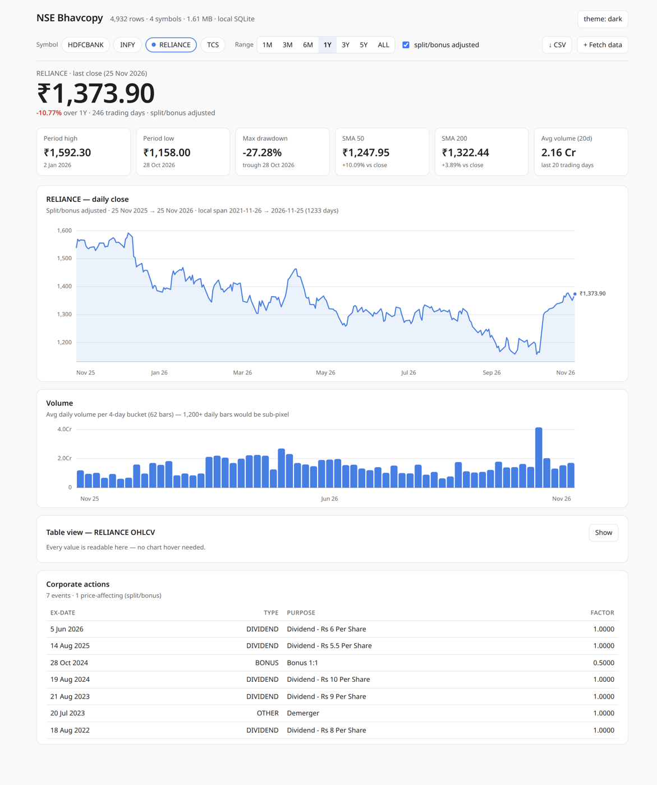
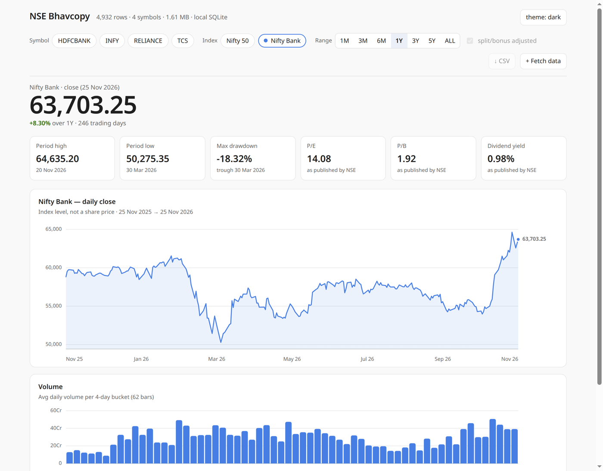
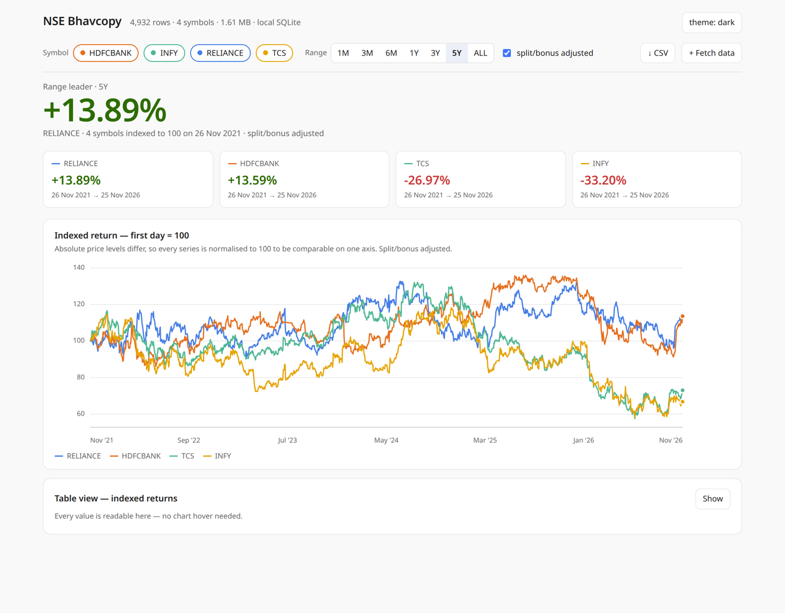

# NSE Bhavcopy — local client

NSE ke official **Bhavcopy MCP server** se EOD data seedha is laptop par uthata hai
aur local SQLite me rakh leta hai. Claude me connector jodne ki zarurat nahi.

Sirf Python 3.9+ stdlib. Koi install nahi, koi API key nahi, koi kharcha nahi (₹0).

---

## Web UI

```bash
python3 serve.py          # http://127.0.0.1:8765
```

Stdlib-only local server + ek single HTML page. Koi npm, koi CDN, koi build step —
offline bhi chalta hai. Charts hand-written inline SVG hain.
UI ka saara text English me hai; yeh README Hinglish me hai.



Kya milta hai:

- **Symbol chips** — 1 chuna to single view, 2–4 chune to comparison. Chip ka rang
  chart ki line ka rang hai.
- **Range** 1M … 5Y / ALL, aur **split/bonus adjusted** toggle — ek hi filter row,
  saare charts ke upar, sab ek saath re-render hote hain.
- **Hero + stat tiles** — last close, period high/low, max drawdown, SMA 50/200,
  20-din avg volume. (SMA poore local history se, kyunki uski definition hi
  "last N trading days" hai — range se nahi badalti.)
- **Price chart** — crosshair + tooltip jo date par snap karta hai, aur keyboard se
  bhi chalta hai (Tab → chart, phir ←/→). Split/bonus ex-dates par vertical hairline.
- **Volume** — alag panel (ek chart par do y-axis kabhi nahi). 1,200+ daily bars
  sub-pixel ho jaate hain, is liye bars bucket ho jaate hain aur subtitle batata hai
  kitne din ka bucket hai.
- **Table view** — har value hover ke bina padhi ja sakti hai.
- **Corporate actions** table, aur CSV download.
- **“+ Fetch data”** — UI se hi naya symbol ya index sync kar sakte ho; log wahin dikhta hai.
  Box me **Stock / Index** toggle hai, kyunki dono alag MCP tool se aate hain.

**Stocks vs indices:** `NIFTY50` naam ka koi NSE *stock* nahi hai — wo ek **index** hai
jiska naam `Nifty 50` (space ke saath) hai aur jo `get_index_history` se aata hai, na ki
`get_stock_history` se. (Lookup me jo `ICICINIFTY`, `HDFCNIFTY` jaise naam milte hain wo
ETFs hain — index ko track karne wale funds, index khud nahi.) Stock mode me index ka naam
daalne par UI ab khud hint deta hai. Index view me P/E, P/B aur dividend yield tiles aate
hain; split/bonus adjust aur CSV export wahan disabled hain (index par lagte hi nahi).



Compare mode sab ko **100 par index** karta hai, kyunki ₹4,000 wala TCS aur ₹800 wala
HDFCBANK ek hi axis par raw price me compare nahi ho sakte:



Dark mode OS setting se aata hai aur `theme` button se override hota hai
([dark screenshot](docs/ui-dark.png)).

**Security:** server sirf `127.0.0.1` par bind hota hai (LAN/internet se koi nahi aa
sakta), sync endpoint cross-site `Origin` wali request reject karta hai, static files
`web/` ke bahar nahi jaate, aur arbitrary SQL endpoint nahi hai. Env se badlo:
`NSE_UI_PORT`, `NSE_UI_HOST`.

---

## Connector ki dikkat kyun nahi aati

NSE ka server `Access-Control-Allow-Origin` me sirf apne domains deta hai
(`nseindia.com`, `nseindia.in`, `mcp.nseindia.in`) — aur region-lock bhi lagta hai.

Par **CORS browser ka rule hai**. Server-to-server ya script se HTTP call karne par
browser hi nahi hota, to CORS check hi nahi hota. Request bhi aapke apne Indian
connection se jaati hai, Anthropic ke cloud se nahi. Dono problem khatam.

Verified (26 Nov 2026, is laptop se):

| server | URL | status |
|---|---|---|
| nse-bhavcopy-redis-mcp v1.0.0 | `https://mcp.nseindia.in/bhavcopy/cm/mcp` | 200 OK, 21 tools, no auth |
| cm-market-mcp v1.0.0 (live) | `https://mcp.nseindia.in/cmmkt/mcp` | 200 OK, 15 tools, no auth |

> NSE ke page par host `msc.nseindia.in` likha hai — wo typo hai. Sahi `mcp.nseindia.in` hai.

---

## 3-mahine per-call cap ka tod

`get_stock_history` ek call me **max 3 mahine** deta hai. Par har response ke aakhir me
`next_end_date` bhi hota hai:

```json
{ "from_date": "2026-08-26", "to_date": "2026-11-25",
  "trading_days": 61, "chunk_months": 3, "next_end_date": "2026-08-25" }
```

Script ussi `next_end_date` ko wapas `endDate` me daalti hai aur peeche-peeche chalti
rehti hai, jab tak target date cover na ho — saare chunks ek hi SQLite table me
`INSERT OR REPLACE` se jud jaate hain (primary key `(symbol, date)`, to overlap se
duplicate nahi banta).

Asli run, RELIANCE 5 saal:

```
[RELIANCE] chahiye 2021-11-26 se aaj tak
    latest    2026-08-26   -> 2026-11-25     61 rows
    chunk 1   2026-05-25   -> 2026-08-25     65 rows
    ...
    chunk 19  2021-11-26   -> 2022-02-07     51 rows
[RELIANCE] local: 1233 trading days  (2021-11-26 -> 2026-11-25)

network calls: 22   time: 52.2s
```

Aur asli faida — **dusri baar**: `coverage` table yaad rakhta hai ki kahan tak maang
liya hai, isliye purane chunks dobara nahi maange jaate:

```
network calls: 3   time: 0.9s     # 1 init + 1 latest chunk + 1 corporate actions
```

Cap teen tarah se hat jaata hai:

1. **Chaining** — 3 mahine ki limit ab sirf page size hai, total limit nahi.
2. **Cache** — jo din ek baar aa gaya, dobara network se nahi aata.
3. **Offline analysis** — `stats`, `export`, `sql` zero network calls lete hain, aur
   SQL me poore 5 saal par kuch bhi pooch sakte ho. Yahan koi cap hi nahi.

Index ke liye `get_index_history` 12 mahine per call deta hai, wahi chaining use hoti hai.

---

## Commands

```bash
# server ke tools dekho
python3 nse.py tools
python3 nse.py tools --live

# 5 saal ka OHLCV + corporate actions local DB me bharo
python3 nse.py sync RELIANCE --years 5
python3 nse.py sync --file watchlist.txt --years 5

# index history
python3 nse.py sync-index "Nifty 50" "Nifty Bank"

# jo DB me pehle se hai, sab aaj tak top-up karo (roz chala sakte ho)
python3 nse.py update

# local cache ka hisaab
python3 nse.py status

# local data se analysis - 0 network calls
python3 nse.py stats RELIANCE
python3 nse.py export RELIANCE                      # split/bonus adjusted CSV
python3 nse.py export RELIANCE --raw                # jaisa bhavcopy me tha
python3 nse.py sql "SELECT date, close FROM prices WHERE symbol='TCS' AND series='EQ' ORDER BY date DESC LIMIT 10"
python3 nse.py stats HDFCBANK --all-series        # non-equity series bhi (prices mix honge)

# koi bhi MCP tool seedha (21 EOD tools + 15 live tools)
python3 nse.py call get_market_breadth date=2026-11-25
python3 nse.py call get_top_movers date=2026-11-25 n=10 direction=gain
python3 nse.py call compare_stocks symbols='["TCS","INFY","WIPRO"]' months=12
python3 nse.py call --live cm_get_stock_quote symbol=RELIANCE
```

Env vars: `NSE_DB` (db path), `NSE_PAUSE` (chunks ke beech gap, default 0.6s),
`NSE_MCP_URL`, `NSE_LIVE_URL`.

---

## Split / bonus adjustment

Bhavcopy prices **unadjusted** hote hain. `get_corporate_actions` ke saath
`adjustmentFactor` aata hai — wo ex-date se *pehle* ke prices par multiplier hai:

| action | factor |
|---|---|
| Face value split Rs10 → Re1 (NESTLEIND, ex 5 Jan 2024) | 0.1 |
| Bonus 1:1 (RELIANCE, ex 28 Oct 2024) | 0.5 |
| Bonus 1:2 (TRENT, ex 4 Jun 2026) | 0.6667 |

`export` aur `stats` by default adjust karte hain:
`adjusted(t) = raw(t) × Π factor` (sirf un actions ka jinki ex-date `t` ke baad hai),
volume ko factor se divide kiya jaata hai. `--raw` se off.

Ek se zyada action compound ho jaate hain. NESTLEIND me split (0.1) aur bonus (0.5)
dono hain, to Jan-2024 se pehle ka factor 0.05 banta hai:

| date | raw close | factor | adjusted |
|---|---|---|---|
| 2024-01-04 | 27,116.40 | 0.05 | 1,355.82 |
| 2024-01-05 (ex-split) | 2,666.40 | 0.5 | 1,333.20 |

Check: RELIANCE 25 Oct 2024 raw close 2655.70 × 0.5 = **1327.85**, aur 28 Oct ka
close 1334.35 — series continuous, bonus par jhoota -50% gap nahi.

---

## Server ka ek silent data bug (handle kiya gaya)

Server har date par **ek hi row** deta hai — aur kuch dates par wo row EQ ki nahi hoti.
HDFCBANK me 17 Jul – 9 Aug 2023 ke 18 din `W3` series (warrant, close ~₹600) ki rows
aati hain, jabki us waqt EQ share ~₹1,650 par tha. `get_ltp_by_date` bhi wahi ₹564.95
deta hai, to EQ price is server se recover nahi ho sakta.

Isse analysis chup-chaap jhoota ho jaata tha: HDFCBANK ka adjusted max drawdown
**-67.31%** dikh raha tha, asli **-32.85%** hai.

Handling:

- `prices` ka primary key `(symbol, date, series)` hai, to koi row doosri ko overwrite
  nahi karti.
- Analysis (`stats`, `export`, `span`) sirf asli-equity series padhti hai:
  `EQ, BE, BZ, SM, ST, BL, T0`. Warrant/rights (`W*`, `N*`, `RE`) bahar.
- Ek date par do series mil jaayein to EQ ko preference milti hai — ek din, ek row.
- `status` me `SKIP` column aur `stats` ke neeche note batata hai kitni rows chhodi gayi:

```
  SYMBOL          DAYS  SKIP  FROM        TO           ACTIONS
  HDFCBANK        1215    18  2021-11-26  2026-11-25         7
  RELIANCE        1233     0  2021-11-26  2026-11-25         7
```

Un 18 dinon ka EQ data nahi hai — gap hai, galat price nahi. `--all-series` se raw
sab kuch dekh sakte ho (par phir prices mix honge).

Note: `T0` (T+0 settlement) aur `BL` (block deal) rows underlying wahi share hoti hain,
is liye wo shaamil hain — 5 saal me gine-chune din aise hote hain.

---

## Jaanne layak limits

- **EOD only.** Intraday candles, ticks, order-book depth kuch nahi. Live snapshot
  ke liye alag `--live` server hai (1–3 min lag), par wo history nahi deta.
- **`deliveryQty` har row me 0** aata hai — server abhi bhejta hi nahi. Column DB me
  hai par bharosa na karo.
- **Index history sirf ~Oct 2024 se.** Stocks ka 5 saal milta hai, index ka nahi —
  chaining khud ruk jaati hai jab data khatam ho jaata hai.
- **Stocks ka data 5 saal tak.** Usse purana server ke paas nahi hai.
- **NSE terms:** data informational/educational use ke liye — real-time trading,
  commercial use ya AI model training ke liye nahi. SEBI disclaimer har response me aata hai.

---

## DB schema (`data/nse.db`)

```
prices(symbol, date, series, open, high, low, close, prev_close,
       volume, traded_value, delivery_qty)        PK (symbol, date, series)
index_prices(index_name, date, open, high, low, close, points_change,
       pct_change, volume, turnover_cr, pe, pb, div_yield)   PK (index_name, date)
actions(symbol, ex_date, action_type, purpose, adj_factor)   PK (symbol, ex_date, purpose)
coverage(kind, key, asked_from, updated_at)                  PK (kind, key)
```

`sqlite3 data/nse.db` se seedha bhi khol sakte ho; DuckDB/pandas bhi padh lenge.

Raw SQL likhte waqt do baatein yaad rakho, warna numbers jhoothe aayenge:
`series IN ('EQ','BE','BZ','SM','ST','BL','T0')` lagao, aur long-range return nikalte
waqt `actions.adj_factor` apply karo (ya `stats` / `export` use karo, wo khud karte hain).

---

## Files

```
nse.py            MCP client + SQLite cache + CLI   (stdlib only)
serve.py          local web server + JSON API       (stdlib only)
web/index.html    poora UI - vanilla JS, inline SVG charts
watchlist.txt     ek symbol per line
data/nse.db       local cache (gitignored)
```

---

## Agar kuch atak jaaye

| dikkat | kya karo |
|---|---|
| purana data dobara try karwana hai | `python3 nse.py sql` read-only hai, is liye: `sqlite3 data/nse.db "DELETE FROM coverage"` |
| symbol nahi mil raha | `python3 nse.py call nse_lookup_symbol query=brig` |
| server slow / timeout | script 3 baar retry karti hai aur session khud dobara banati hai; `NSE_PAUSE=1.5` se halka chalao |
| region block | script laptop se chalti hai, is liye India me problem nahi; VPN off rakho |
